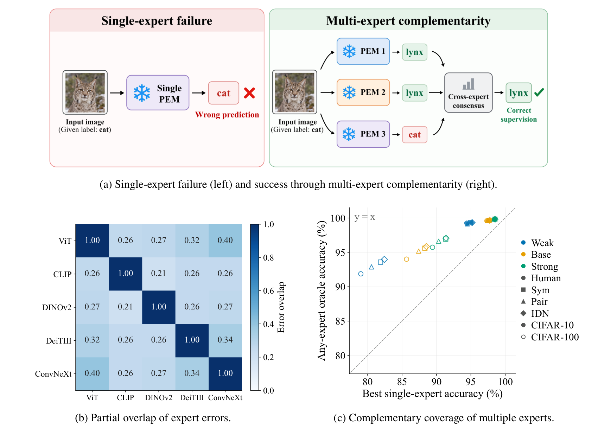

# Cross-Expert Reliability-Guided Supervision Stratification for Learning with Noisy Labels

PyTorch implementation of **Cross-Expert Reliability-Guided Supervision
Stratification (CRSS)**.

**Honglei Gao, Senyu Hou, Gaoxia Jiang, Wenjian Wang**

This repository provides the core CRSS implementation: frozen feature
extraction, Stage I supervision stratification, and Stage II robust linear training.
The released reproduction protocol covers CIFAR-10 and CIFAR-100 under
Weak/Base/Strong expert configurations.

## Abstract

Label noise is widespread in large-scale datasets and can substantially degrade supervised
learning and model generalization. Traditional learning with noisy labels (LNL) methods
typically adopt an end-to-end training paradigm, using noisy labels for both sample selection
and representation learning, which may lead to self-confirmation bias. Frozen pretrained expert
models (PEMs) provide stable visual representations and offer a promising approach to learning
with noisy labels. However, existing methods often rely on a single PEM and remain susceptible
to model-specific prediction biases. To address this limitation, we propose Cross-Expert
Reliability-Guided Supervision Stratification (CRSS), which exploits complementary evidence from
multiple frozen PEMs. CRSS first exploits complementary predictions from multiple frozen
pretrained experts and models their instance-wise reliability to assess noisy supervision. It
then combines cross-expert consensus with reliability-validated correction to partition training
samples into reliable clean, correctable noisy, and uncertain subsets. Finally, a lightweight
linear classifier is trained with differentiated supervision for the three subsets, enabling
robust utilization of all training samples. Theoretically, we analyze the proposed method from
the perspectives of consensus-based sample selection, reliability-guided label correction, and
robust learning with uncertain supervision. Experiments across different expert configurations
and datasets with synthetic and real-world label noise demonstrate that the proposed method
achieves superior performance in sample stratification, classification accuracy, and prediction
calibration.

## Framework



**Figure 1. Motivation of CRSS.** A single pretrained expert can reinforce an
incorrect observed label, while complementary expert predictions can recover
the correct class. Partially overlapping errors and the gap between the best
single expert and the retrospective any-expert oracle motivate combining
cross-expert consensus with instance-wise reliability assessment. The figure
is reproduced from Figure 1 of the manuscript, including all three panels.

## Reproduction

Install Python 3.11 and a compatible PyTorch/torchvision pair, then:

```bash
git clone https://github.com/HongleiGao1/CRSS.git
cd CRSS
pip install -r requirements.txt
```

Place CIFAR data and the official CIFAR-N annotations under `../DATASETS/`:

```text
../DATASETS/
  cifar-10-batches-py/
  cifar-100-python/
  noise_label_human/
    CIFAR-10_human.pt
    CIFAR-100_human.pt
```

Run the complete CIFAR-10 protocol:

```bash
python prepare_labels.py --dataset cifar10
python run_extract.py --config server --dataset cifar10 --model-scale all --split all --device cuda:0
python run_crss_matrix.py --dataset cifar10 --cuda 0 --resume
```

Replace `cifar10` with `cifar100` for CIFAR-100. Each matrix command runs
48 conditions: three expert scales multiplied by one Human annotation and
five seeds each of Symmetric (0.6), Pairflip (0.3), and IDN (0.4) noise.
Use `--data-root` and `--cache-root` to select existing data and caches.
Observed labels are prepared once and shared across scales; existing labels
are validated and reused.

For one condition, or one stage:

```bash
python run_crss.py --dataset cifar10 --model-scale base --noise sym --seed 1 --cuda 0 --resume
python run_crss.py --stage stage1 --dataset cifar10 --model-scale base --noise sym --seed 1
python run_crss.py --stage stage2 --dataset cifar10 --model-scale base --noise sym --seed 1 --cuda 0 --resume
```

No YAML or protocol JSON file is required. Defaults are embedded in Python;
CLI options override them. Single-condition runs and feature extraction default
to Base. The matrix runner defaults to all three scales.

| Expert | Weak | Base | Strong |
| --- | --- | --- | --- |
| ViT | B/32 | B/16 | L/16 |
| CLIP | B/32 | B/16 | L/14 |
| DINOv2 | S/14 | B/14 | L/14 |
| DeiTIII | S/16 | B/16 | L/16 |
| ConvNeXtV2 | Tiny | Base | Large |

Checkpoint identifiers are in [the model registry](crss/models/model_registry.py).
RC uses observed-label CE, CN uses hard USC-label CE, and U uses observed-label
GCE; every sample contributes to training. The five experts stay frozen and
Stage II trains a linear head on the matching ViT features. Existing model
versions, preprocessing, scale-isolated caches and legacy Base reuse are retained.

The reproduced protocol evaluates test accuracy each epoch and restores the
earliest strictly best checkpoint; raw ECE15 is reported at that same checkpoint.
Training uses at most 100 epochs and stops after 20 epochs without improvement.
The test set is therefore also used for checkpoint selection.

## Code and outputs

```text
CRSS/
  run_extract.py          # one/all scales and train/test frozen features
  prepare_labels.py       # immutable observed-label caches
  run_crss.py             # one CRSS condition, Stage I and/or Stage II
  run_crss_matrix.py      # 48 conditions for one dataset
  crss/                   # method and its required runtime modules
  assets/framework.png    # manuscript Figure 1
  README.md
  requirements.txt
```

Stage I results are saved under `outputs/crss_stage1/`; Stage II results under
`outputs/crss_stage2/`, separated by dataset, scale, noise and seed. The latter
includes `metrics.json`, `history.csv`, `metadata.json`, `best_head.pt` and
`test_predictions.npz`. Features are under `cache/features/`, and observed
labels under `cache/noise/stage12/`. Data, caches, results, comparison methods,
local configuration files and supplementary documentation are excluded from Git.

## Citation

If you use this code or build on this work, please cite:

```bibtex
@unpublished{gao2026crss,
  title  = {Cross-Expert Reliability-Guided Supervision Stratification for Learning with Noisy Labels},
  author = {Gao, Honglei and Hou, Senyu and Jiang, Gaoxia and Wang, Wenjian},
  year   = {2026},
  note   = {Manuscript}
}
```
