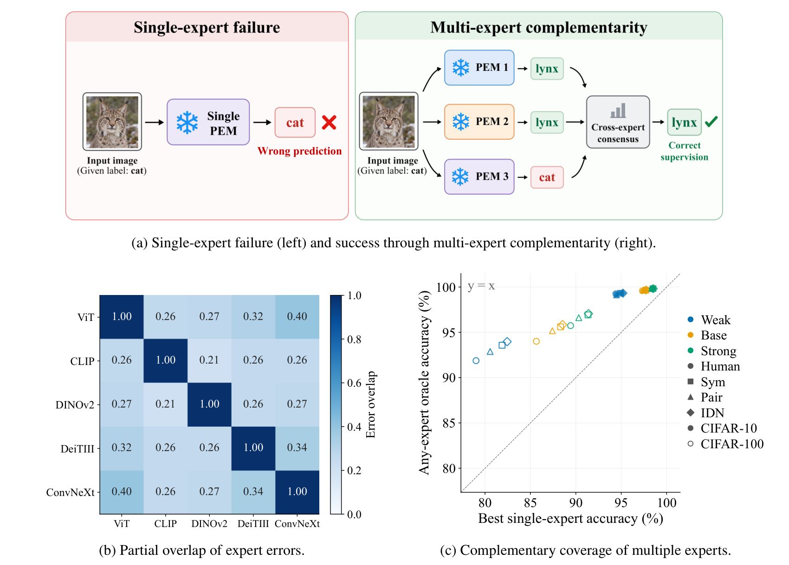

# Cross-Expert Reliability-Guided Supervision Stratification for Learning with Noisy Labels

PyTorch implementation of **Cross-Expert Reliability-Guided Supervision
Stratification (CRSS)**.

**Honglei Gao, Senyu Hou, Gaoxia Jiang, Wenjian Wang**

The released pipeline extracts frozen expert features, prepares observed labels,
partitions supervision, and trains a linear classifier for CIFAR-10 and CIFAR-100.

## Abstract

Label noise is prevalent in large-scale datasets, degrading supervised learning and model generalization. Conventional learning with noisy labels (LNL) methods often jointly perform sample selection and representation learning using noisy annotations, making sample selection susceptible to self-confirmation bias. Frozen pretrained expert models (PEMs) provide stable visual representations for assessing noisy supervision; however, existing approaches often rely on a single PEM and remain vulnerable to model-specific prediction biases. To address this limitation, we propose Cross-Expert Reliability-Guided Supervision Stratification (CRSS), which exploits complementary evidence from multiple frozen PEMs and models their instance-wise reliability. Specifically, CRSS first establishes a binary supervision partition (CRSS-B) by integrating cross-expert consensus and instance-wise reliability modeling. To mitigate potential misassignments arising from binary decisions, CRSS further introduces consensus-based screening and reliability-validated correction, refining the binary partition into three subsets (CRSS-T): reliable clean, correctable noisy, and uncertain samples. Finally, CRSS trains a lightweight classifier through differentiated supervision, with the contribution of each sample guided by its estimated reliability, thereby enabling more effective utilization of training data with varying supervision quality. Experiments across multiple expert configurations and datasets with synthetic and real-world label noise demonstrate the effectiveness of CRSS in supervision stratification, classification accuracy, and confidence--accuracy calibration.

## Framework



**Figure 1. Motivation of CRSS.** A single pretrained expert can reinforce an
incorrect observed label, while complementary expert predictions can recover
the correct class. Partially overlapping errors and the gap between the best
single expert and the retrospective any-expert oracle motivate combining
cross-expert consensus with instance-wise reliability assessment. The figure
is reproduced from Figure 1 of the manuscript, including all three panels.

## Run CRSS

Install the runtime dependencies with `pip install -r requirements.txt`.
The commands below use CIFAR-10, Base experts, and symmetric noise with seed 1.
Training runs for 100 epochs, measures test accuracy after every epoch, and
saves the earliest checkpoint attaining the highest test accuracy.

```bash
python run_extract.py --config server --dataset cifar10 --data-root ../DATASETS/ --model-scale base --split all --device cuda:0 --download
python prepare_labels.py --dataset cifar10 --data-root ../DATASETS/ --noise sym --seed 1
python run_crss.py --dataset cifar10 --model-scale base --noise sym --seed 1 --cuda 0 --resume
```

## Citation

If you use this code or build on this work, please cite:

```bibtex
@unpublished{gao2026crss,
  title  = {Cross-Expert Reliability-Guided Supervision Stratification for Learning with Noisy Labels},
  author = {Gao, Honglei and Hou, Senyu and Jiang, Gaoxia and Wang, Wenjian},
  year   = {2026},
  note   = {Manuscript}
}
```
